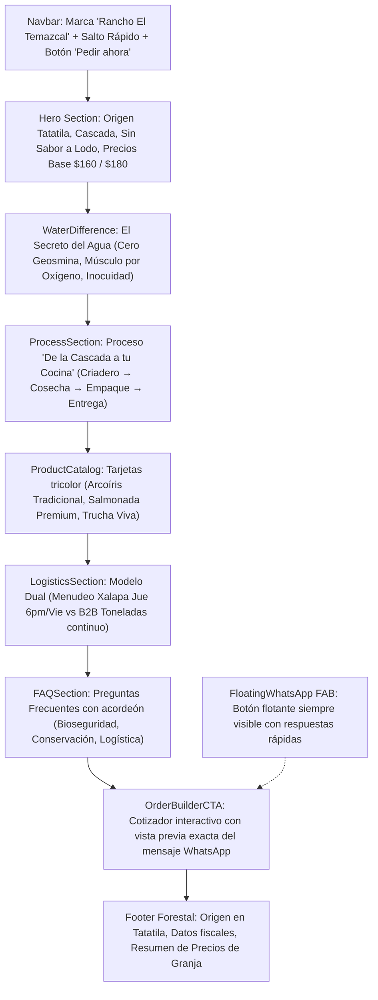

# Sistema de Diseño UI/UX: "Del Manantial"
### Rancho El Temazcal · Tatatila, Veracruz

> **Documento de Especificación de Diseño Frontend**  
> *Versión 2.0 — Enfoque Editorial Gastronómico & Comercial Campestre*

---

## 1. Filosofía del Concepto

**Rancho El Temazcal** no es una empresa de tecnología ni una fintech; es un **centro de producción acuícola de montaña** fundado sobre el respeto a un recurso natural privilegiado: el flujo continuo de una cascada de manantial en la sierra de Tatatila, Veracruz.

El sistema de diseño **"Del Manantial"** está concebido bajo el lenguaje visual de las **publicaciones editoriales gastronómicas de alta gama** (revistas culinarias, libros de origen botánico y cartas de productores artesanales). 

### Pilares Rectores:
* **Enfoque de Alto Volumen & Mayoreo:** La prioridad comercial absoluta es el abasto constante por tonelada y medio mayoreo a distribuidores, restaurantes, marisquerías y centrales de abasto (como La Nueva Viga y Puebla). La venta minorista en Xalapa se mantiene como ruta secundaria complementaria.
* **Calidez Orgánica:** Fondos claros con matiz crema/papel de algodón (`#fdfcf7`) que transmiten luz natural, sanidad y frescura diurna.
* **Tipografía con Oficio:** Combinación de una tipografía serif renacentista (*Cormorant Garamond*) para títulos evocadores con una tipografía humanista limpia (*DM Sans*) para datos comerciales y lectura fluida.
* **Honestidad de Productor:** Presentación sobria y directa de los precios de granja, las tallas, las condiciones de entrega en frío y las políticas de bioseguridad.
* **Cero Artificio Tecnológico:** Se descartan deliberadamente elementos que sugieran software o dashboards (modo oscuro sintético, fuentes monoespaciadas, resplandores neón y terminología críptica).

---

## 2. Decisiones de Diseño: ¿Por qué se descartó la versión anterior?

| Elemento descartado (V1) | Motivo del descarte | Solución adoptada en "Del Manantial" (V2) |
| :--- | :--- | :--- |
| **Fondo Negro / Dark Mode (`stone-950`)** | Asociado a cripto, fintech o consolas de videojuegos. Comunica frialdad y artificialidad; antagónico a un rancho al aire libre con agua transparente y truchas vivas. | **Fondo Crema Cálido (`cream-50` #fdfcf7)** que evoca papel artesanal, limpieza, luz de montaña y sanidad alimentaria. |
| **Fuente Monoespaciada (`font-mono`)** | Remite a código de programación, terminales de servidor y finanzas cuantitativas. Descontextualiza un producto perecedero del campo. | **Versalitas clásicas en DM Sans (`text-xs tracking-widest uppercase`)** para metadatos comerciales y etiquetas. |
| **Efectos Neón & Shimmers Azules** | Sensación de interfaces de ciencia ficción o interfaces financieras en tiempo real. | **Sombras orgánicas difusas**, bordes color crema tostado (`cream-300`) y micro-elevaciones suaves (`card-lift`). |
| **Barra de Alerta Roja/Amarilla Superior** | Provocaba sensación de sitio en error o portal burocrático. | **Tarjetas y badges integrados de origen** ("Solo Entregas Programadas", "No Turismo") comunicados con elegancia desde el primer scroll. |

---

## 3. Paleta Cromática (Tokens de Color)

La paleta se inspira en el bosque de niebla de Tatatila, la roca de manantial, el agua viva de cascada y la pigmentación salmón natural:

```
[ Crema Papel ]     [ Verde Bosque ]     [ Azul Manantial ]     [ Cobre / Terracota ]     [ Tinta ]
   #fdfcf7              #325e28               #165c6e                 #c05621              #111008
```

### 3.1. Fondo & Superficies (Cream Paper)
* `--color-cream-50: #fdfcf7`: Fondo principal de la aplicación. Cálido, descansa la vista y transmite pureza.
* `--color-cream-100: #f6f3ea`: Superficie de tarjetas secundarias, franjas alternas de contenido y contenedores.
* `--color-cream-200: #ece8d8`: Delimitadores suaves y bordes de componentes.
* `--color-cream-300: #ddd8c4`: Bordes de mayor jerarquía y líneas divisorias.

### 3.2. Color Primario: Bosque de Niebla (Forest)
Evoca la vegetación perenne de Tatatila, la frescura y la tradición agrícola:
* `--color-forest-950: #0f1c0d`: Textos principales en el hero y títulos de máximo impacto; fondo solemne del footer.
* `--color-forest-900: #192e15`: Títulos de tarjetas y destacados.
* `--color-forest-700: #325e28`: Color primario de acción (botones principales, badges de menudeo, enlaces destacados).
* `--color-forest-600: #3f7530`: Estado `:hover` de botones principales.
* `--color-forest-100: #d6efca`: Fondos de etiquetas y badges sutiles.
* `--color-forest-50:  #eef8e8`: Acentos decorativos de fondo orgánico.

### 3.3. Color Secundario: Agua de Cascada (Spring)
Representa la corriente cristalina, la oxigenación constante y la sanidad del agua:
* `--color-spring-900: #0e3a46`: Títulos del módulo de mayoreo B2B.
* `--color-spring-700: #165c6e`: Títulos secundarios de agua, acentos itálicos en el Hero y enlaces de manantial.
* `--color-spring-500: #208099`: Líneas decorativas y marcadores de comparación.
* `--color-spring-100: #c8eaf2`: Fondo de la tarjeta de Trucha Arcoíris Tradicional y selecciones de texto (`::selection`).
* `--color-spring-50:  #e9f6fa`: Fondo de contraste para la sección comparativa de agua.

### 3.4. Color de Acento: Terracota / Salmón (Copper)
Dedicado exclusivamente a la trucha salmonada, notas gourmet y advertencias operativas amables:
* `--color-copper-700: #8b3a1a`: Título y acentos del corte salmonado gourmet.
* `--color-copper-500: #c05621`: Botón de acción para pedir trucha salmonada y avisos de horario de corte.
* `--color-copper-100: #fbe8db`: Badge de producto gourmet y fondo de advertencia logística.
* `--color-copper-50:  #fdf3ed`: Superficie de tarjeta para productos salmonados.

### 3.5. Tipografía & Textos (Ink)
* `--color-ink-950: #111008`: Tinta casi negra para títulos y cifras numéricas.
* `--color-ink-800: #2a2820`: Párrafos de lectura principal.
* `--color-ink-600: #4a4838`: Descripciones de producto y notas explicativas.
* `--color-ink-400: #7a7866`: Metadatos, etiquetas secundarias y fechas de entrega.
* `--color-ink-200: #c2c0b2`: Separadores decorativos.

---

## 4. Tipografía & Jerarquía Visual

```
Tipografía Display: Cormorant Garamond (Google Fonts)
Tipografía de Lectura & UI: DM Sans (Google Fonts)
```

### 4.1. `Cormorant Garamond` (Serif Display)
Inspirada en la tipografía clásica de Claude Garamont del siglo XVI. Se utiliza para:
* **H1 Hero Principal:** `font-display text-6xl sm:text-7xl lg:text-8xl leading-[0.9] text-forest-950`
* **H2 Encabezados de Sección:** `font-display text-5xl sm:text-6xl text-forest-950 leading-tight`
* **Nombres de Producto:** `font-display text-2xl text-forest-950`
* **Cifras de Precios:** `font-display text-4xl text-forest-900`

### 4.2. `DM Sans` (Humanist Sans-Serif)
Tipografía geométrica con trazos humanistas cálidos y alta legibilidad en pantallas móviles:
* **Cuerpo de texto general:** `text-sm sm:text-base text-ink-600 leading-relaxed`
* **Botones e interactivos:** `text-sm font-semibold tracking-normal`
* **Etiquetas y Eyebrows (Versalitas):** `text-xs font-semibold tracking-widest uppercase` (p. ej. *"PRODUCCIÓN ACUÍCOLA · ALTA MONTAÑA"*)

---

## 5. Arquitectura de Secciones y Flujo de Usuario

El sitio sigue un embudo narrativo enfocado en resolver las tres dudas críticas del cliente: **¿De dónde viene?**, **¿Por qué sabe mejor?** y **¿Cómo y cuándo me llega?**:



---

## 6. Especificación de Componentes Clave

### 6.1. Navbar (`Navbar.tsx`)
* **Comportamiento dinámico:** Pasa de ser completamente transparente en el tope a un fondo blanco cálido translúcido (`bg-cream-50/97 backdrop-blur-md border-b border-cream-200`) al hacer scroll más de 60px.
* **Marca:** Nombre del rancho en serif con subtítulo geográfico en versalitas.
* **CTA móvil y escritorio:** Botón redondo verde bosque con icono de WhatsApp.

### 6.2. Hero Section (`HeroSection.tsx`)
* **Doble Columna Armónica:** Texto y propuesta a la izquierda con estadísticas de precio granja (\$160 y \$180); a la derecha, fotografía principal enmarcada con badges flotantes:
  - *Badge inferior:* "Origen certificado: Tatatila, Veracruz · Agua de cascada natural".
  - *Badge superior:* "Solo entregas · Sin visitas al rancho — operación por bioseguridad".
* **Llamados a la Acción:** Botón sólido de compra para familias y botón outlined para compradores comerciales B2B.

### 6.3. Sección de Calidad del Agua (`WaterDifference.tsx`)
* **3 Pilares Conceptuales:** Sin sabor a tierra (eliminación de geosmina), Músculo de corriente (oxigenación natural), Inocuidad sin químicos.
* **Tabla Comparativa Gastronómica:** Contrapone en paralelo el pescado de *Estanque Convencional* (sabor a lodo, bajo oxígeno, químicos) frente a la trucha de *Cascada de Tatatila* (agua virgen 24/7, musculatura tersa, inocuidad biológica).

### 6.4. Proceso en 4 Pasos (`ProcessSection.tsx`)
* **Estructura:** 4 columnas conectadas por una sutil línea horizontal editorial:
  1. *Criadero en cascada:* flujo continuo de nacimiento.
  2. *Cosecha a pedido:* sin producto acumulado en congeladores.
  3. *Procesado higiénico:* eviscerado, limpio y al alto vacío o bolsa térmica.
  4. *Entrega en frío:* rutas de viernes en Xalapa y cajas térmicas para envíos regionales.

### 6.5. Catálogo de Productos (`ProductCatalog.tsx`)
Cada producto posee un acento cromático propio para facilitar su distinción inmediata:
* **Trucha Arcoíris Tradicional:** Acento `spring` (azul agua fresca), \$160 MXN/kg, talla 350g–600g (plato individual).
* **Trucha Salmonada (Corte Premium):** Acento `copper` (terracota gourmet), \$180 MXN/kg, talla 500g–1.5kg, color naranja intenso, alternativa fresca frente al salmón importado congelado.
* **Trucha Viva:** Acento `forest` (verde vida), para estanques y repoblación acuícola.
* **Ficha de Empaque:** Respaldo sobre conservación y cadena de frío.

### 6.6. Módulo Logístico con Prioridad de Alto Volumen (`LogisticsSection.tsx` y `DeliveryMap.tsx`)
* **Columna 1 (Protagonista · 7 columnas, borde destacado y badge superior):** Abasto Mayorista por Tonelada para Restaurantes, Pescaderías y Distribuidores (destinos: La Nueva Viga en CDMX, Puebla, Xalapa, Veracruz), suministro continuo 52 semanas del año, rejas plásticas calibradas, cajas térmicas selladas y botón principal de cotización inmediata a WhatsApp.
* **Columna 2 (Complementaria · 5 columnas):** Ruta Local al Menudeo en Xalapa con entrega semanal los viernes (corte los jueves a las 6:00 PM). Aclaración reiterada de bioseguridad (no hay visitas turísticas en el rancho).
* **Mapa Cartográfico Topográfico (`DeliveryMap.tsx`):**
  - Ilustración vectorial artesanal basada en curvas de nivel y formas orgánicas (*decorative blobs* en crema, bosque y agua).
  - **Epicentro:** Tatatila, Veracruz (coordenadas 19°41'N 97°07'O a ~1,800 msnm con pulso de agua viva).
  - **3 Radios de Cobertura interactivos:**
    1. *Radio 1 (Verde · 1h):* Xalapa, Coatepec y zona conurbada.
    2. *Radio 2 (Azul · 1.5 - 3h):* Corredor Puebla, Tlaxcala y Veracruz Puerto.
    3. *Radio 3 (Terracota · 3.5 - 4.5h):* CDMX (La Nueva Viga, Central de Abasto y cadenas restauranteras).

### 6.7. Capa de Componentes UI Base (`src/components/ui/`)
* **Utilidad `cn` (`src/lib/utils.ts`):** Motor de composición de clases para Tailwind condicional limpio.
* **`Input.tsx`:** Campo de texto con etiquetas en versalitas, focus con halo verde bosque y manejo de errores.
* **`Button.tsx`:** Botón con variantes semánticas (`primary`, `secondary`, `outline`, `whatsapp`, `ghost`).
* **`Badge.tsx`:** Píldoras de estado en paleta `forest`, `spring`, `copper` y `neutral`.

### 6.7. Preguntas Frecuentes (`FAQSection.tsx`)
* Acordeón interactivo con filtrado por píldoras (*Todas*, *Sobre la Trucha*, *Ruta Xalapa*, *Mayoreo B2B*).
* Resuelve con empatía y formalidad las dudas recurrentes de los clientes locales y mayoristas.

### 6.8. Módulo de Contacto Directo WhatsApp en 1 Clic (`OrderBuilderCTA.tsx`)
* **Objetivo de Conversión Inmediata:** Se elimina la fricción de formularios obligatorios. En su lugar, se presentan **3 tarjetas directas de 1 solo clic** que abren la conversación de WhatsApp con el mensaje ya redactado:
  1. 🟢 **"Quiero trucha para mi casa (Xalapa)":** Para familias locales (entrega de viernes).
  2. 🔵 **"Cotizar por Mayoreo o Toneladas":** Para restaurantes, marisquerías y distribuidores.
  3. 💬 **"Tengo una duda o pregunta":** Para consultas rápidas de tallas o preparación.
* **Calculador Opcional Colapsable:** Para usuarios que sí deseen calcular kilos y montos antes de enviar, existe un acordeón opcional (*"¿Ya sabes cuántos kilos quieres?"*) que genera el desglose sin obligar a nadie a llenarlo.
* **Erradicación del Término "B2B":** Sustituido por lenguaje comercial natural en México: *"Venta por Mayoreo"*, *"Restaurantes y Distribuidores"*, *"Abasto por Toneladas"*.

### 6.9. Botón Flotante (`FloatingWhatsApp.tsx`)
* Aparece con suavidad a los 2.5 segundos de navegación en la esquina inferior derecha.
* Al hacer clic, despliega un menú compacto con 3 accesos directos (*Pedir para casa en Xalapa*, *Cotizar mayoreo B2B*, *Consulta general*) con textos preconfigurados.

---

## 7. Micro-animaciones y Accesibilidad

* **Aparición Progresiva (`useReveal`):** Observer que aplica la clase `.reveal.visible` con una transición suave (`0.65s ease`) al entrar en pantalla, respetando a los elementos ya visibles en el viewport inicial.
* **Micro-elevación (`.card-lift`):** Las tarjetas de producto se elevan sutilmente 4 píxeles con una sombra verde bosque al colocar el cursor.
* **Pulso Suave (`.wa-pulse`):** El botón de WhatsApp emite un halo sutil cada 2.5 segundos para guiar la conversión sin resultar invasivo.
* **Contraste WCAG AA:** Todas las combinaciones de texto (`forest-950` e `ink-800` sobre `cream-50` y blanco) superan el ratio de contraste 4.5:1 exigido para legibilidad óptima.

---

## 8. Guía de Estilo para Fotografía Real Futura

Para reemplazar los espacios reservados (`aspect-[4/3]` y `aspect-[4/5]`) se recomienda seguir las siguientes pautas fotográficas:

1. **Iluminación:** Luz natural matutina o de tarde nublada típica de la sierra de Tatatila (luz difusa sin sombras duras).
2. **Fotografía de Cascada y Estanques:** Tomas con velocidad de obturación balanceada donde se aprecie la turbulencia del agua blanca oxigenada cayendo a los estanques de roca limpia.
3. **Fotografía de Producto Crudo:** Ejemplares recién cosechados colocados sobre lecho de hielo triturado o tabla de madera maciza, acompañados de elementos naturales (ramas de romero, limón amarillo, sal de grano).
4. **Corte Salmonado:** Toma de detalle en ángulo de 45° mostrando el grosor del lomo y el veteado naranja vivo para contrastar visualmente con el salmón comercial importado.
5. **Empaque:** Fotos limpias del pez sellado al alto vacío en su bolsa térmica, transmitiendo pulcritud y cadena de frío impecable.

---

*Rancho El Temazcal — Calidad, Frescura y Agua Viva de Tatatila, Veracruz.*
